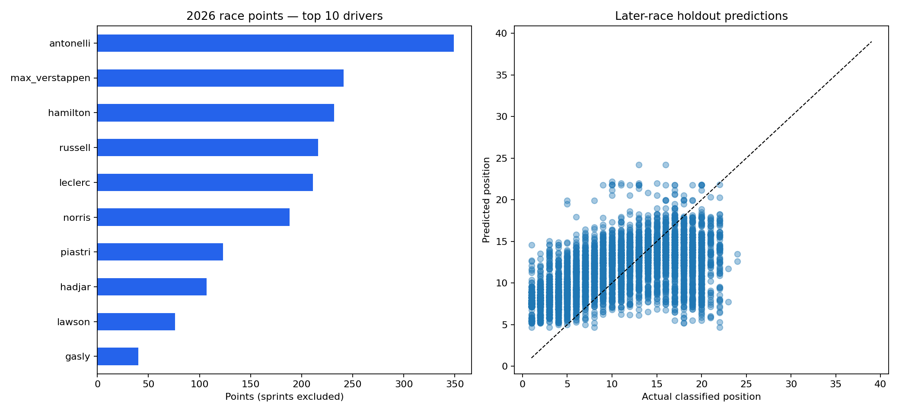

# F1 Data Pipeline & Race Outcome Analysis

A reproducible data science project exploring how starting position, driver and constructor relate to Formula 1 race classification. Includes source caching, validation, descriptive analysis, a chronological prediction experiment, Parquet storage and an optional GCS/Airflow ingestion path.

## Run the analysis

Install [uv](https://docs.astral.sh/uv/getting-started/installation/) and use Python 3.10 or later:

```bash
uv sync --locked
uv run python -m f1_pipeline.analysis
uv run python -m pytest
```

By default the analysis fetches every season from 1950 through the latest season reported by Jolpica. Only published race results are included; future races are excluded. Use `--year 2024` for one season or `--start-year 2018 --end-year 2026` for a range. The latest selected season is refreshed on every API run; use `--refresh` to refresh the bulk archive or historical API pages too.

The first full-history run requires internet access. It downloads Jolpica’s public delayed bulk CSV archive, normalizes the relational tables, and replaces the latest selected season with fresh API results. The archive and source JSON are cached in `data/source/`. Use `--source api` for the slower paginated-only path. Subsequent runs can use that cache. Delete the season's cached files to refresh. Outputs in `data/analysis/`:

- `analysis.png`: top drivers by race points and holdout prediction plot.
- `results.parquet`: validated race results.
- `driver_summary.csv`: race points and average classified position per season and driver.
- `season_coverage.csv`: race and entry counts for each season.
- `manifest.json`: run time, coverage and latest included round.
- `holdout_predictions.csv`: individual model and baseline predictions.
- `metrics.json`: train/test rounds, row counts and errors.

To analyze a previously exported results CSV:

```bash
uv run python -m f1_pipeline.analysis --input results.csv --output data/custom
```

CSV columns: `season,round,race,driver,constructor,grid,position,points,status`. Use numeric rounds, grid, position and points. The validator rejects missing data, duplicate season-round-driver-position entries and invalid numeric values. Season and round together identify a race. Historic shared drives can give one driver more than one classified entry; these entries are preserved, with position included in the uniqueness key.

## Verified full-history run

The 1950–2026 run includes **1,168 races and 26,291 classified result entries**, through 2026 round 19 (Mexico City, November 1). Future events and entries without a classified position in the archive are excluded. The full-history holdout produced MAE **4.07** for ridge regression versus **3.77** for the grid baseline: the baseline performs better. This exposes the weakness of fitting fixed driver and team effects over many eras. The coverage manifest is the authority for each run.



See `reports/season_coverage.csv` and `reports/manifest.json` for the verified snapshot.

## Reference single-season experiment

A live 2024 run returned 479 race entries. The first 18 rounds (359 entries) were used for training; the final six rounds (120 entries) were held out:

| Method | Holdout MAE, finishing positions |
| --- | ---: |
| Predict starting grid | 3.60 |
| Ridge regression | 3.13 |

The full-history command evaluates on the last quarter of season-round event keys and reports its own metrics. The chart shows points for the latest included season; cumulative points across eras are not comparable because scoring systems changed.

Lower is better. This is one season and one holdout, not evidence of performance across seasons. No hyperparameter search was conducted. Read [methodology](docs/METHODOLOGY.md) for assumptions, limitations and interview discussion points.

## FastF1 session extraction

For detailed laps/results/weather, write available datasets locally:

```bash
uv run python -m scripts.fastf1_extractor 2024 1 R --output-dir data/raw
```

For GCS, configure [Application Default Credentials](https://cloud.google.com/docs/authentication/provide-credentials-adc) with object-write permission, then:

```bash
export GCP_PROJECT_ID="your-project-id"
export GCS_BUCKET_NAME="your-bucket-name"
uv run python -m scripts.fastf1_extractor 2024 1 R
```

Files use `raw/fastf1/year=2024/round=1/session_type=R/` partitions. Timedeltas become seconds and missing values remain null. Empty or unavailable datasets are skipped and saved datasets are reported. Runs fail if none are available. Re-runs overwrite individual files; writes are not atomic across datasets and older files are not deleted. A partial extraction is not a complete session.

Live timing requests returned HTTP 401 in the development environment. Results were still available through the fallback service. The analysis command above uses the working Jolpica results API directly, without requiring lap timing. Authentication restrictions cannot be repaired by changing local parsing code.

## Optional fastest-lap plot

```bash
uv run main.py --year 2024 --round 1 --drivers VER PIA NOR --output fastest-laps.png
```

Requires working FastF1 lap access. Omit `--round` for a season, or `--output` for a desktop window. The chart shows fastest lap time against lap number; times from different circuits are not directly comparable.

## Airflow deployment

`dags/f1_raw_ingestion_dag.py` defines an Airflow 2.x DAG with manual year/round/session parameters, two retries and one active run. Deploy the DAG to a separately provisioned Airflow environment; install the runtime dependencies and make the repository root importable on every worker. Configure GCS credentials and environment variables there. Trigger `f1_raw_ingestion` manually. Airflow is not installed in the local analysis environment; this DAG has not been integration-tested on Composer. The hello-world DAG is a separate connectivity example.

## Layout and verification

`f1_pipeline/` contains the analysis; `scripts/` handles raw extraction; `test/` has offline tests for serialization, missing datasets, quality rules, chronological splitting and exclusion of post-race points from model features. GitHub Actions runs the tests on pushes and pull requests. Historical experiments in `tempfiles/` and `dailylog.md` are not part of the supported workflow.

Data comes from [Jolpica](https://github.com/jolpica/jolpica-f1) and [FastF1](https://docs.fastf1.dev/). Follow their access and usage terms. No license has been selected for this repository; contact its owner before reusing or redistributing the code.
